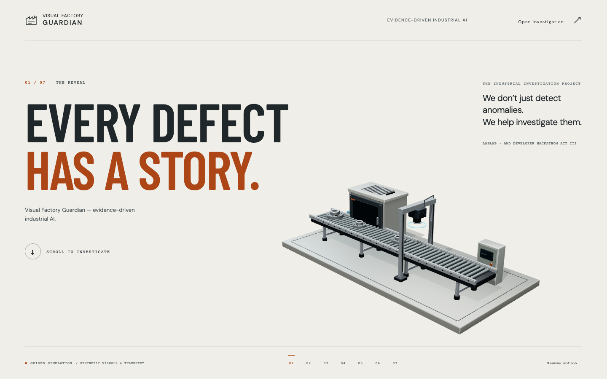
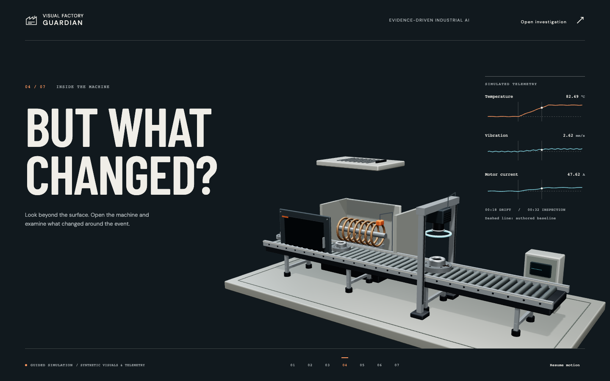
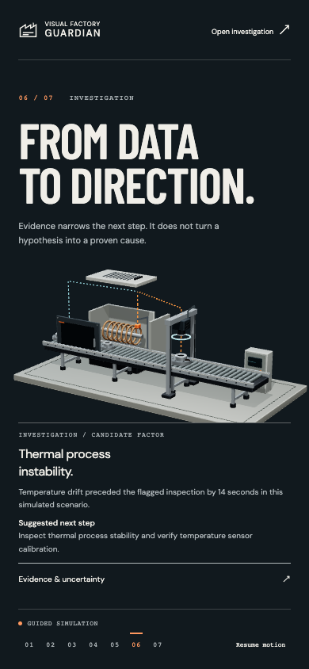

# Cinematic landing — implementation and verification

## Scope and provenance

Implemented on `codex/cinematic-factory-story`, based on main `bb1e6e2`. The existing operator application is now at `/dashboard`; `/` introduces it through seven scroll-controlled chapters. No backend, vision, telemetry or existing application component was rewritten.

The supplied 11.133-second coffee-product recording was inspected at half-second intervals before implementation. The new work transfers its warm editorial canvas, dominant physical subject and continuous transitions. It contains no reference-video frames or copied branding/assets. See [the design contract](CINEMATIC_DESIGN.md).

The narrative follows P-004 / evt-004 from the existing frontend's `thermal-drift-001` fixture. Temperature drift begins at 18 seconds and the inspection occurs at 32 seconds. The visual crack and localization indicator are original conceptual geometry, not an ML localization output. Telemetry is explicitly simulated. The explanation is deterministic, proposes a candidate factor and alternative, and includes no invented citation or confidence percentage. AMD adapter code exists; AMD inference performance has not been verified by this landing-page work.

## Architecture

- `src/cinematic/director.ts`: pure camera/target and mechanical state sampling from normalized progress. Smooth held compositions interpolate in both directions. Portrait uses a bounded assembly framing; reduced motion uses chapter camera cuts.
- `Landing.tsx`: one cleaned-up GSAP ScrollTrigger, seven semantic chapters, projected editorial layers, fixture-based SVG traces, evidence timeline, native uncertainty disclosure, chapter anchors and explicit simulation labeling. Inactive chapters are inert and hidden from assistive technology.
- `Stage.tsx`: persistent lazy-loaded R3F Canvas, local studio environment, lighting, camera director, WebGL/context-loss fallback and rendering instrumentation. Hidden tabs, reduced motion and the pause control use demand rendering.
- `Machinery.tsx`: original machined flange, inspection camera/ring light, conveyor rollers/fasteners, removable service panels, thermal coil, motor fins, sensors, control cabinet and foundation. Repeated rollers/bolts are instanced. Locally generated roller texture and shared signal material are disposed on unmount.
- Existing dashboard CSS and modules load only on the dashboard route. Both routes use the existing static-host SPA rewrite.
- All landing assets, including licensed fonts, are bundled locally. After initial loading, the story can complete offline. There is no offline-first installer or service worker.

## Executed validation

Environment: macOS arm64, Node 25.8.1, Chrome 155.0.8059.82, Apple M4 Pro / ANGLE Metal. Mobile sizes below are desktop browser viewport emulations, not physical phone measurements.

- `npm run build`: TypeScript and production Vite build passed.
- `npm test`: 25 tests passed, including existing app/API/scenario tests and three director tests for continuity, reversibility and bounded inputs.
- `npm run format:check`: passed.
- Full Playwright suite: 12 tests passed. After final trace-reveal, reduced-motion, font and skip-link refinements, all five cinematic browser tests were rerun and passed. Includes all existing dashboard tests, presentation/fullscreen, replay, API failure handling and accessibility checks.
- Cinematic tests cover one-Canvas identity, forward/reverse equality, assembly reset, offline story completion, keyboard chapter navigation, evidence disclosure, reduced-motion preference changes, WebGL-disabled fallback and the dashboard link.
- Seven chapters captured at 1920×1080, 1440×900, 1366×768, 768×1024, 390×844 and 320×740. No horizontal page overflow at these sizes. Desktop/tablet/mobile screenshots were visually inspected and framing corrected.
- Automated axe WCAG A/AA checks passed at reveal, telemetry, investigation and conclusion. These checks do not establish full accessibility conformance or substitute for manual assistive-technology testing.

Commands from `frontend/`:

```sh
npm ci
npm run build
npm test
npm run format:check
# Install Playwright Chromium or set PLAYWRIGHT_CHROMIUM_EXECUTABLE.
npm run test:e2e
```

## Rendering measurements

Raw results are in [CINEMATIC_PERFORMANCE.json](CINEMATIC_PERFORMANCE.json). The script measures actual R3F frame-counter advancement while scrolling the entire story over six seconds, plus browser animation-frame intervals. Warm-up is 1.5 seconds. One run per viewport; no concurrent browser test suite. Draw-call and triangle figures are the maximum observed sampled Three.js render counters, not GPU profiler measurements. Environment-map passes can temporarily reset those counters.

| Viewport | Rendered cadence | Browser frame interval p95 | Peak sampled draws / triangles |
|---|---:|---:|---:|
| 1440×900 | 60.1 frames/s | 16.7 ms | 186 / 48,058 |
| 390×844 (same desktop GPU) | 60.0 frames/s | 16.7 ms | 186 / 48,058 |

To reproduce, start `npm run preview -- --port 4173` in one terminal, then run `node scripts/measure-cinematic.mjs` in another. Set `PLAYWRIGHT_CHROMIUM_EXECUTABLE` when using an installed Chrome binary and `VFG_PREVIEW_URL` to change the target. The results apply to this machine and short test, not every device or a long-duration soak test.

## Screenshots





## Limits and publication

- No Safari/Firefox or physical phone validation was performed.
- The existing dependency audit reports three development-tool advisories involving Vitest, its mocker and Tinypool. The new runtime packages were not listed. A Vitest major upgrade is outside this landing-page change; do not expose its development server publicly.
- Vite emits existing Zod PURE-comment warnings but completes successfully.
- Backend modules were preserved and their tests were not rerun for this frontend-only change. No live backend integration is claimed for the landing.
- Public hosting is separate from publishing a Git branch/PR. A local preview URL is not a public deployment. This change does not merge main or assert a successful hosting deployment.
